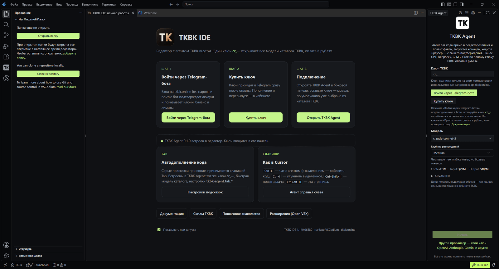
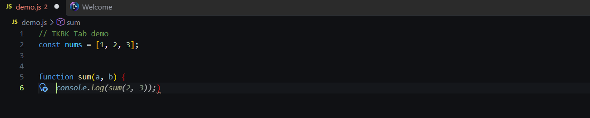

# TKBK IDE

Настольный редактор кода под брендом TKBK на базе [VSCodium](https://github.com/VSCodium/vscodium)
с предустановленным агентом [TKBK Agent](https://github.com/tkbk-online/tkbk-agent) и готовым
подключением к шлюзу TKBK. Один ключ `cr_…` открывает все модели каталога TKBK, оплата в рублях.



Это **не форк VS Code**. Репозиторий содержит только скрипты сборки: они берут официальный релиз
VSCodium, меняют оболочку (`product.json`, иконки, имена запускаемых файлов) и добавляют расширения.
Обновления редактора приходят вместе с новыми релизами VSCodium — достаточно поменять номер версии
и пересобрать.

## Что внутри

| Компонент | Как поставляется |
|---|---|
| VSCodium 1.140.x (Code - OSS, MIT) | бинарный релиз, без пересборки |
| TKBK Agent — форк Cline под брендом TKBK | встроенное расширение (`resources/app/extensions/tkbk-agent`) |
| Страница «Начало работы», первый запуск, раскладка «агент справа», горячие клавиши как в Cursor | встроенное расширение `tkbk-welcome` |
| **TKBK Tab** — автодополнение кода по Tab через шлюз TKBK | встроено в TKBK Agent (настройки `tkbk-agent.tab.*`) |
| Тема «TKBK Dark» (цвета tkbk.online) | встроенное расширение `tkbk-theme` |
| Русский языковой пакет, GitLens | `.vsix` из Open VSX, ставятся в профиль пользователя |
| Магазин расширений | Open VSX (как у VSCodium) |

Бренд: `nameShort`/`nameLong` «TKBK IDE», `applicationName` `tkbk-ide`, папка данных `~/.tkbk-ide`,
профиль `%APPDATA%\TKBK IDE` (Windows) / `~/Library/Application Support/TKBK IDE` (macOS) /
`~/.config/TKBK IDE` (Linux), URL-схема `tkbk-ide://`, автообновление VSCodium отключено,
телеметрия выключена. Серверные компоненты (Remote SSH и т. п.) остаются VSCodium-овскими,
чтобы удалённая разработка продолжала работать.

## Первый запуск

1. Открывается страница **TKBK IDE: начало работы**: «Войти через Telegram-бота» → tkbk.online/login,
   «Купить ключ» → tkbk.online/buy, «Подключение» → панель TKBK Agent.
2. Справа (как в Cursor) открыт **TKBK Agent**: поле для ключа `cr_…`, модель по умолчанию из каталога
   TKBK. Вернуть агента в левую панель: команда «TKBK IDE: Агент слева» или кнопка на странице.
3. Интерфейс сразу на русском (языковой пакет + `argv.json` с `locale: ru`).
4. Пошаговое знакомство: Справка → Начало работы → «TKBK IDE: подключение за 3 шага».

В папке, открытой в «ограниченном режиме» (workspace trust), агент, как и любое расширение без
поддержки недоверенных папок, отключён до нажатия «Доверять». Перенос вправо выполнится,
как только агент станет доступен.

## TKBK Tab — автодополнение



Серые подсказки при вводе кода, принимаются клавишей **Tab** (отклонить — Esc, следующая — Alt+]).
Автодополнение встроено в TKBK Agent: ключ берётся из агента (или `TKBK_API_KEY`), модель по
умолчанию `deepseek-v4-pro` (быстрая и дешёвая), выключатель `tkbk-agent.tab.enabled`, остальные
настройки `tkbk-agent.tab.*`, пункт «TKBK Tab» в строке состояния (модель, журнал, вкл/выкл).

- Что отправляется: до 6000 символов до курсора и 1500 после, имя файла, язык и несколько недавних
  правок из других файлов. Файлы `.env`, ключи и сертификаты (`*.pem`, `*.key`, `secrets.*`) не
  отправляются никогда.
- Пауза 150 мс после ввода, кэш подсказок, повтор без запроса при «допечатывании» подсказки,
  одна строка при вводе в середине строки и несколько строк в начале блока.
- Расширение `extensions/tkbk-complete` — та же логика как самостоятельное расширение для обычного
  VS Code/VSCodium без агента (ключ в своём защищённом хранилище). В комплект TKBK IDE оно не входит,
  чтобы не было двух источников подсказок.

## Горячие клавиши (как в Cursor)

| Клавиши | Действие |
|---|---|
| `Ctrl+L` | чат с агентом; с выделением — добавить код в чат; в терминале — добавить вывод |
| `Ctrl+I` | улучшить выделенный код с TKBK Agent |
| `Ctrl+Shift+E` | объяснить выделенный код |
| `Ctrl+Shift+I` | новая задача агента |
| `Ctrl+Alt+H` | страница «Начало работы» |
| `Tab` / `Esc` / `Alt+]` | принять / отклонить / следующая подсказка TKBK Tab |

На macOS вместо `Ctrl` — `Cmd`.

## Артефакты

| Платформа | Файл | Где собирается |
|---|---|---|
| Windows x64 | `TKBK-IDE-Setup-win32-x64-<версия>.exe` — установщик (Inno Setup, по умолчанию для текущего пользователя) | локально и в CI |
| Windows x64 | `TKBK-IDE-win32-x64-<версия>.zip` — portable: распаковать и запустить `TKBK IDE.exe`, профиль лежит в папке `data/` | локально и в CI |
| Linux x64 | `TKBK-IDE-linux-x64-<версия>.tar.gz` (portable, `data/` внутри; `resources/tkbk-ide.desktop` для меню) | CI |
| macOS arm64 / x64 | `TKBK-IDE-darwin-<arch>-<версия>.zip` с `TKBK IDE.app` (ad-hoc подпись) | CI |

Версия TKBK IDE совпадает с версией VSCodium, на которой она собрана (сейчас `1.140.06880`).

Что делает установщик Windows: копирует редактор в `%LOCALAPPDATA%\Programs\TKBK IDE`
(или `Program Files` при выборе установки для всех), создаёт ярлыки, по желанию — пункт
«Открыть в TKBK IDE» в контекстном меню файлов и папок и команду `tkbk-ide` в PATH, регистрирует
схему `tkbk-ide://`, ставит в профиль пользователя русский пакет и GitLens и сразу включает русский
интерфейс. Удаление — через «Приложения» Windows.

## Сборка

Нужны Node.js ≥ 20 и интернет (скачиваются релиз VSCodium и `.vsix` из Open VSX).
Для установщика Windows — Inno Setup 6 (`ISCC.exe` ищется в стандартных путях или по переменной `ISCC`).

```bash
npm ci
npm test
node build/build.mjs --platform win32-x64 --agent-vsix path/to/tkbk-agent-0.1.0.vsix
```

Параметры `build/build.mjs`:

| Флаг | Значение |
|---|---|
| `--platform` | `win32-x64`, `linux-x64`, `darwin-x64`, `darwin-arm64` (по умолчанию — текущая машина) |
| `--codium <tag>` | релиз VSCodium (по умолчанию `VSCODIUM_VERSION` из `build/config.mjs`) |
| `--agent-vsix <path>` | путь к `.vsix` TKBK Agent; иначе берётся из последнего релиза `tkbk-online/tkbk-agent` (или `TKBK_AGENT_VSIX`) |
| `--no-installer` | не собирать `.exe` |
| `--no-preinstall` | не создавать portable-профиль `data/` |
| `--out <dir>` | папка результатов (по умолчанию `dist/`) |

Как устроен конвейер (`build/`):

- `fetch.mjs` — скачивает релиз VSCodium с проверкой sha256, подбирает версии `.vsix` из Open VSX,
  совместимые с движком редактора (языковой пакет не может быть новее редактора).
- `build.mjs` — распаковывает, накладывает `brand/product.json` (ключ `null` удаляет поле,
  `$append`/`$prepend` дополняют массивы), генерирует иконки из `brand/logo.png` (`.ico`, `.icns`, PNG),
  переименовывает исполняемые файлы и лаунчеры, прописывает иконку и версию в `.exe` (rcedit),
  копирует встроенные расширения, кладёт `.vsix` в `resources/app/bundled-extensions/`,
  создаёт portable-профиль и `languagepacks.json`, упаковывает архив и вызывает Inno Setup.
- `langpack.cjs` — генератор `languagepacks.json` (кэш языковых пакетов VS Code). Сам VS Code создаёт
  его только во время GUI-сессии, поэтому без генератора первый запуск был бы на английском.
- `icons.mjs` — ICO/ICNS без внешних утилит; `gen-theme.mjs` — пересборка темы из Dark Modern.
- Тесты `build/*.test.mjs` проверяют слияние `product.json` и текстовые «якоря» в скриптах запуска
  VSCodium на реальных файлах релиза (`build/test-fixtures/`): если VSCodium поменяет скрипты,
  упадёт CI, а не сборка у пользователя.

### Обновление на новую версию VSCodium

1. Поменять `VSCODIUM_VERSION` в `build/config.mjs` (или передать `--codium`).
2. `npm test` — если упали тесты якорей, обновить `build/test-fixtures/` из нового релиза и списки
   замен в `build/build.mjs`.
3. Собрать и проверить первый запуск.

### CI

`.github/workflows/build.yml`: матрица Windows / Linux / macOS (arm64, x64). Запуск вручную
(можно указать версию VSCodium и URL `.vsix` агента) или по тегу `v*` — тогда создаётся черновик
релиза с артефактами и sha256. По умолчанию `.vsix` агента берётся из последнего релиза
репозитория `tkbk-online/tkbk-agent`.

## Структура

```
brand/            product.json с брендом, logo.png, monogram.svg
build/            конвейер сборки, Inno Setup-скрипт, тесты и фикстуры
extensions/
  tkbk-welcome/   страница «Начало работы», первый запуск, раскладка, горячие клавиши, установка комплекта
  tkbk-complete/  TKBK Tab как самостоятельное расширение для сторонних редакторов (не в комплекте IDE)
  tkbk-theme/     тема TKBK Dark
docs/             скриншот, список задач владельцу
```

## Что требует владельца

См. [docs/OWNER-TODO.md](docs/OWNER-TODO.md): подпись кода (Windows и macOS), релиз `.vsix`
агента, иконка, домены, публикация.

## Лицензии

Скрипты этого репозитория — MIT ([LICENSE](LICENSE)). VSCodium и Code - OSS — MIT, TKBK Agent
(форк Cline) — Apache-2.0, остальное — см. [NOTICE](NOTICE).
